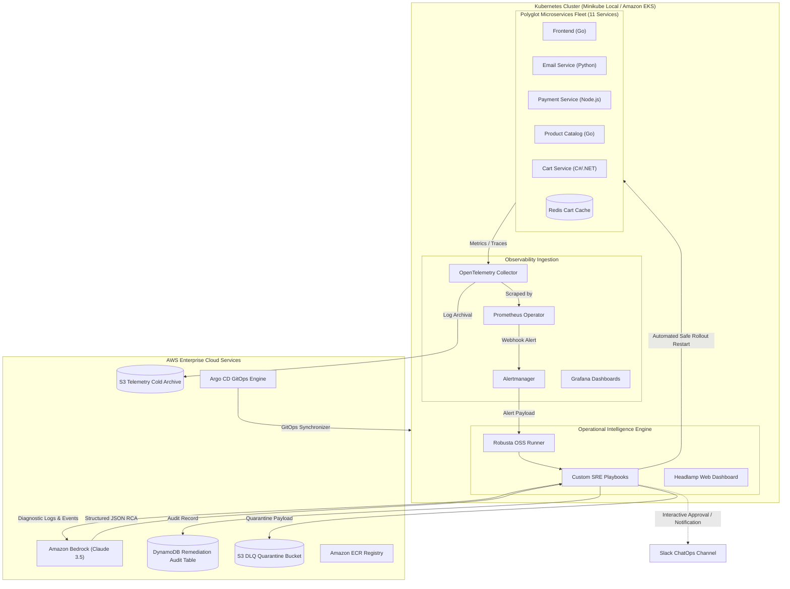
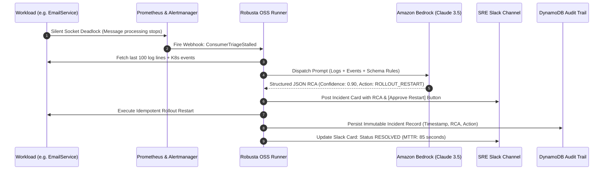

# ⚡ OmniPulse: Autonomous AIOps & SRE Operational Intelligence Platform for Amazon EKS

[](https://aws.amazon.com/eks/)
[](https://www.terraform.io/)
[](https://robusta.dev/)
[-232F3E?logo=amazon-aws&logoColor=white)](https://aws.amazon.com/bedrock/)
[](https://opentelemetry.io/)
[](https://argo-cd.readthedocs.io/)
[](LICENSE)

> **Enterprise-grade Autonomous Incident Response, Real-Time Telemetry Pipeline, and Self-Healing Platform Engine for Kubernetes microservice fleets.** Built to cut Mean-Time-To-Resolution (MTTR) from **45 minutes to < 3 minutes** with zero-hallucination AI diagnostics and Human-in-the-Loop (HITL) ChatOps.

---

## 🎯 Executive Summary & Architectural Motivation

In modern cloud-native microservice architectures, traditional APM alerts trigger catastrophic alert fatigue. Critical failure modes—such as **deadlocked streaming sockets**, **malformed poison pills in Dead Letter Queues (DLQs)**, and **transient 429 foundation model API quota exhaustion**—frequently bypass standard Kubernetes liveness and readiness probes, leaving services silently broken.

**OmniPulse** bridges observability and autonomous remediation:
1. **End-to-End Observability Pipeline**: Continuous telemetry ingestion across 11 polyglot microservices via OpenTelemetry Collector and Kube-Prometheus-Stack.
2. **Context-Aware Incident Triage**: Robusta OSS intercepts firing alerts and correlates recent pod logs with Kubernetes events.
3. **AI Root Cause Analysis (RCA)**: Diagnostic context is enriched via **Amazon Bedrock (Claude 3.5 Haiku / Sonnet)** with strict JSON schema guardrails.
4. **Idempotent Self-Healing & ChatOps**: Safe remediations are executed automatically; high-blast-radius actions trigger interactive Slack approval buttons.
5. **Immutable Compliance Audit Trail**: Every prompt, diagnosis, and remediation execution is recorded in **Amazon DynamoDB**.

---

## 🏗️ System Architecture

### Platform Topology



### Incident Response & Remediation Flow



---

## 🛡️ SRE Incident Playbook Matrix

| Failure Mode | Detection Trigger | Root Cause Analysis | Remediation Action | Blast Radius Control |
| :--- | :--- | :--- | :--- | :--- |
| **1. Deadlocked Consumer** | `ConsumerTriageStalled` (Restarts > 1 in 5m or Unacked Age > 120s) | Silent socket deadlock or thread starvation | Safe `rollout restart` of target deployment | Automated (Idempotent) |
| **2. DLQ Poison Pill** | `PubSubDLQBackpressure` (Surge > 100 msgs in DLQ) | Schema violation / malformed JSON payload | Drains poisoned message to S3 quarantine bucket | Automated with schema diff |
| **3. LLM 429 Quota Exhaustion** | `VertexAIQuotaExhausted` / `RateLimit429Surge` | Token-Per-Minute (TPM) burst against Bedrock/Vertex API | Throttles batch worker concurrency & triggers exponential backoff | Dynamic scale-down |
| **4. Storefront HTTP 5xx Surge** | `FrontendHTTP5xxRateHigh` (> 5% errors over 2m) | Downstream connection pool exhaustion | Rollout restart + cache warm-up | Automated restart |
| **5. Pre-OOMKill Memory Saturation** | `ContainerMemoryNearLimit` (> 85% memory limit) | Slow heap leak before OS OOMKill | Proactive rolling restart before process crash | Rolling zero-downtime |
| **6. Sustained CPU Saturation** | `ContainerCPUNearLimit` (> 85% CPU limit over 2m) | Runaway loop or request spike | Rollout restart / horizontal pod trigger | Safe rolling restart |

---

## 🚀 Quickstart: Local Development via Minikube

To ensure zero cloud breakage and rapid local iteration, OmniPulse can be fully deployed in **Minikube** without needing AWS credentials or incurring cloud bills.

### Prerequisites
* [Minikube](https://minikube.sigs.k8s.io/) (v1.30+)
* [Docker Desktop](https://www.docker.com/)
* [Kubectl](https://kubernetes.io/docs/tasks/tools/)
* [Terraform](https://www.terraform.io/) (v1.5+)
* Python 3.11+

### 1. Launch Minikube Cluster
```bash
minikube start --cpus=4 --memory=6144 --addons=ingress
```

### 2. Deploy Local OmniPulse Stack
```bash
# Uses Kustomize local overlay with public Google Online Boutique images
kubectl apply -k k8s/overlays/local
```

### 3. Verify Microservices Health
```bash
kubectl get pods -n omnipulse-local
```
*All 11 microservices + Redis will reach `Running (1/1)` status within ~90 seconds.*

### 4. Access the Storefront
```bash
minikube service frontend-external -n omnipulse-local
```

### 5. Run AIOps Diagnostic Unit Tests
```bash
make test-aiops
```
*Validates the multi-provider diagnostic engine, zero-hallucination fallbacks, and local audit logging.*

---

## ☁️ Production Deployment: Amazon EKS

### 1. Provision Infrastructure via Terraform
```bash
cd terraform/aws/environments/dev

# Copy example variables
cp terraform.tfvars.example terraform.tfvars

# Initialize & Apply
terraform init
terraform plan
terraform apply -auto-approve
```

### 2. Connect Kubectl to EKS
```bash
aws eks update-kubeconfig --region us-east-1 --name omnipulse-eks-dev
```

### 3. Deploy Workloads via AWS Overlay
```bash
kubectl apply -k k8s/overlays/aws-dev
```

### 4. Deploy Robusta with AWS Values
```bash
helm repo add robusta https://robusta-charts.storage.googleapis.com
helm repo update
helm upgrade --install robusta robusta/robusta \
  --namespace robusta --create-namespace \
  -f k8s/robusta/values-aws.yaml
```

---

## 🔒 Security, Compliance & FinOps Highlights

* **Keyless Identity (Zero Static Secrets)**: 100% keyless AWS IAM OIDC federation for GitHub Actions CI/CD and **IAM Roles for Service Accounts (IRSA)** for in-cluster pods.
* **Least-Privilege Scoping**: Robusta runner IAM policy is strictly scoped to `bedrock:InvokeModel`, specific DynamoDB table ARN, and S3 quarantine bucket ARN.
* **Cold Storage Lifecycle (FinOps)**: OTel telemetry archive automatically transitions to S3 Standard-IA at 30 days, Glacier at 90 days, and Deep Archive at 365 days.
* **Serverless Audit Store**: DynamoDB configured with `PAY_PER_REQUEST` billing—incurs $0 cost when idle.
* **Shift-Left Static Analysis**: Automated CI pipeline runs `terraform fmt`, `kubectl kustomize` validation, and Python unit tests on every pull request.

---

## 📂 Repository Structure

```
├── .github/
│   └── workflows/
│       └── ci.yaml                     # Automated CI/CD pipeline (Lint, Test, OIDC Build)
├── gitops/
│   └── argocd-apps/                    # Argo CD App-of-Apps and application manifests
├── k8s/
│   ├── base/                           # Base microservices manifests (100% cloud-agnostic)
│   ├── overlays/
│   │   ├── local/                      # Minikube local overlay (public images, NGINX ingress)
│   │   ├── dev/                        # GCP legacy overlay (for reference/migration)
│   │   └── aws-dev/                    # AWS EKS overlay (ALB ingress, ECR images, IRSA)
│   ├── otel/                           # OpenTelemetry Collector deployment & pipelines
│   ├── robusta/                        # Robusta OSS values (values-local.yaml & values-aws.yaml)
│   └── headlamp/                       # Headlamp cluster dashboard
├── src/
│   ├── adservice ... shippingservice   # 11 Polyglot microservices source code
│   └── robusta-playbooks/              # Custom SRE AIOps Playbooks
│       ├── aiops_diagnostics.py        # Multi-provider Bedrock/Vertex/Local AI RCA engine
│       ├── audit_sink.py               # DynamoDB & Local JSONL audit trail logger
│       ├── stalled_consumer_playbook.py# Deadlock triage & self-healing
│       ├── dlq_poison_pill_playbook.py # Poison pill detection & quarantine
│       └── vertex_quota_backoff_playbook.py # LLM 429 quota exhaustion handler
├── terraform/
│   ├── aws/                            # AWS EKS Production Infrastructure
│   │   ├── environments/dev/           # Dev environment root module
│   │   └── modules/                    # Modular VPC, EKS, IRSA, ECR, Storage, OIDC
│   └── modules/                        # GCP legacy modules
├── tests/
│   └── test_aiops_diagnostics.py       # Automated unit tests for AIOps engine
├── Makefile                            # Developer experience CLI
└── README.md                           # Platform documentation & architectural specification
```

---

## 👨‍💻 Author & Contact

Architected and maintained by **DevOps & Platform Engineering Team**. Open for Senior/Lead Cloud Architect, Platform Engineer, and Principal SRE discussions.

