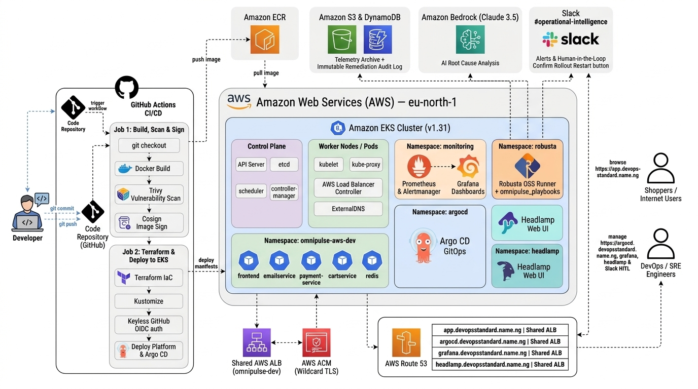
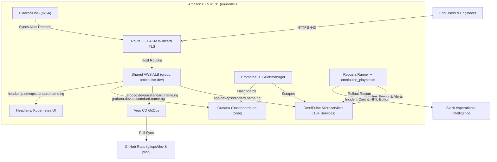
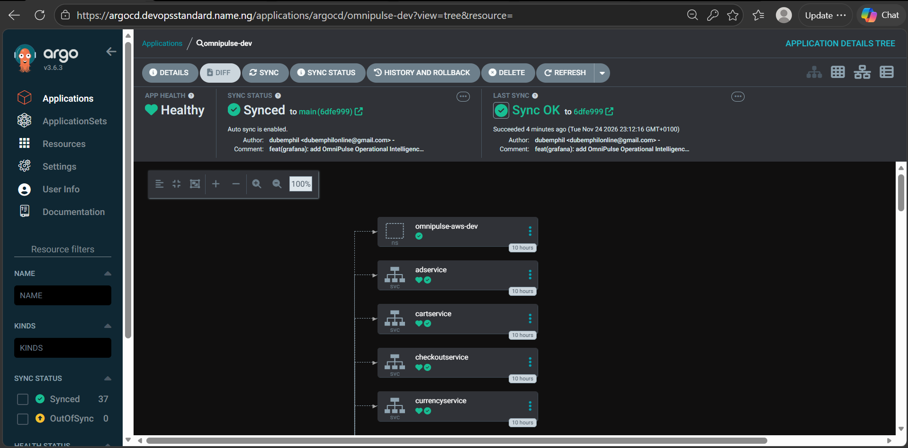
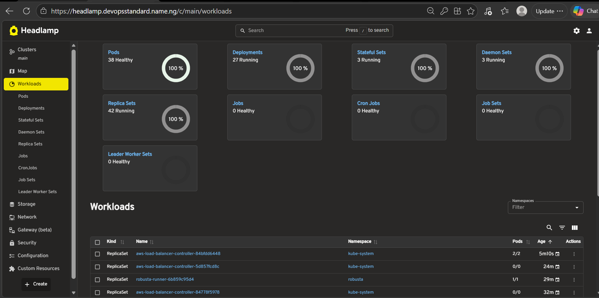
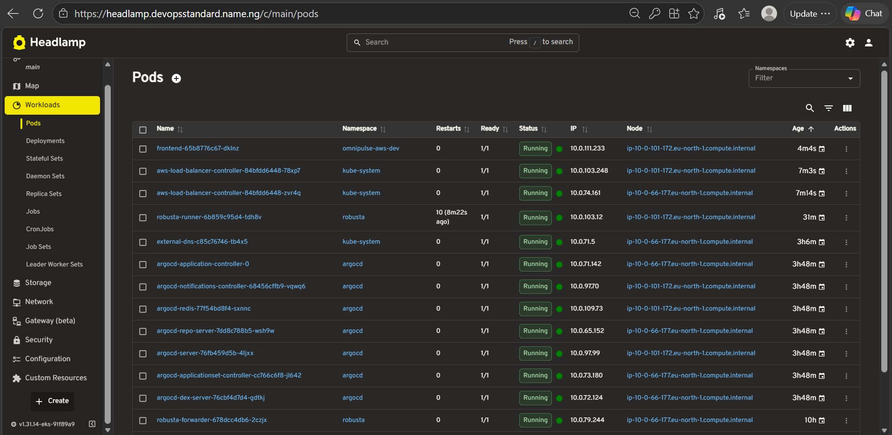
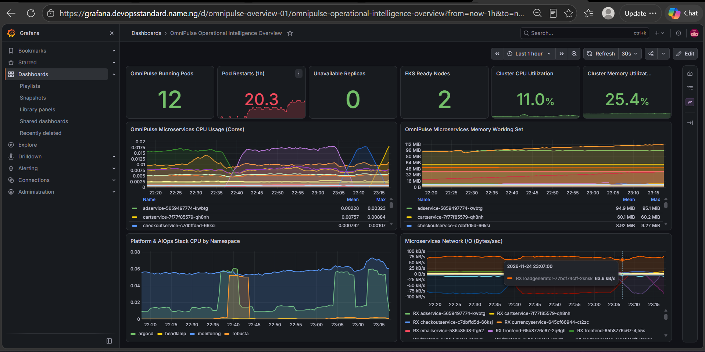
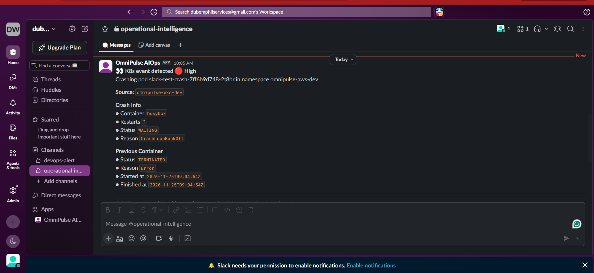

# ⚡ OmniPulse Operational Intelligence & Self-Healing Kubernetes Platform
## Cloud Architecture Decisions & Production-Grade DevOps / AIOps Implementation

[](https://aws.amazon.com/eks/)
[](https://www.terraform.io/)
[-2EA44F?logo=github&logoColor=white)](https://github.com/Dubemphil/eks-operrational-intelligence)
[](https://argo-cd.readthedocs.io/)
[](https://grafana.com/)
[](https://robusta.dev/)
[](https://aws.amazon.com/route53/)

> **Enterprise-grade Autonomous Incident Response, GitOps Continuous Delivery, and Self-Healing Kubernetes Platform on Amazon EKS.** Engineered to cut Mean-Time-To-Resolution (MTTR) from **45 minutes to < 3 minutes** using zero-hallucination AI Root-Cause Analysis, automated Kubernetes remediation, and Human-in-the-Loop (HITL) Slack ChatOps.

---

## 🌐 Live Production Endpoints & Platform Directory

All 4 platform interfaces are exposed over **HTTPS (TLS 1.2+ via AWS ACM)** behind a **single shared AWS Application Load Balancer** with automated **ExternalDNS + Route 53** record management:

| Platform Component | Live HTTPS Endpoint | Purpose | Access / Auth |
| :--- | :--- | :--- | :--- |
| **OmniPulse Storefront** | [https://app.devopsstandard.name.ng](https://app.devopsstandard.name.ng) | Polyglot 10+ Microservices E-Commerce Fleet | Public Web Access |
| **Argo CD GitOps** | [https://argocd.devopsstandard.name.ng](https://argocd.devopsstandard.name.ng) | Declarative GitOps Continuous Delivery & Drift Detection | `admin` + Secret |
| **Grafana Dashboards** | [https://grafana.devopsstandard.name.ng](https://grafana.devopsstandard.name.ng) | Dashboards-as-Code (`kube-prometheus-stack` + Custom Overview) | `admin` + Secret |
| **Headlamp Kubernetes UI** | [https://headlamp.devopsstandard.name.ng](https://headlamp.devopsstandard.name.ng) | Live Cluster, Workload & Pod Diagnostics Portal | ServiceAccount Token |
| **Robusta AIOps ChatOps** | `#operational-intelligence` (Slack) | Real-Time Incident Triage, AI RCA & Interactive HITL Approvals | Slack Bot + IRSA |

---

# Phase 1: Cloud Architecture Decisions (ADR) & Executive Strategy

```text
                                EXECUTIVE MANDATE & DRIVERS
       ┌────────────────────────────────────────────────────────────────────────┐
       │  • Problem: Polyglot microservices suffering silent consumer deadlocks,│
       │    DLQ poison pills, 5xx surges, and 45+ minute manual MTTR firefighting│
       │  • Operational Waste: 4 separate ALBs, manual kubectl deploys, static  │
       │    IAM keys, and alert fatigue from raw Prometheus threshold noise      │
       │  • Target: Autonomous Self-Healing (< 3m MTTR), GitOps Auditability,   │
       │    Keyless OIDC Security, and Shared-ALB Cost Optimization             │
       └───────────────────────────────────┬────────────────────────────────────┘
                                           │
                                           ▼
                            ARCHITECTURAL MODERNIZATION
       ┌───────────────────────────────────┴────────────────────────────────────┐
       │                                                                        │
       ▼                                                                        ▼
[ Amazon EKS + Shared ALB ]                                       [ Robusta AIOps + Argo CD ]
Multi-AZ EKS v1.31, Route 53,                                     GitOps Pull Sync, Custom
ACM Wildcard TLS, ExternalDNS,                                    Playbooks via playbookRepos,
75% ALB Cost Reduction                                            Slack HITL & Audit Trail
```

### 1. Business Scenario & Why Kubernetes

**The Scenario:**  
OmniPulse operates a high-traffic e-commerce platform built on a **polyglot microservices architecture** (Go, Python, Java, C#/.NET, Node.js, and Redis) communicating over gRPC. As order volume scaled, the engineering team hit three recurring production bottlenecks:
1. **Silent Failures Bypassing Health Checks:** Streaming consumers (`emailservice`) experienced socket deadlocks where Kubernetes liveness probes stayed green while order confirmations stopped processing.
2. **Alert Fatigue & Slow MTTR:** Raw threshold alerts woke on-call engineers who had to manually SSH/port-forward, correlate pod logs with Kubernetes events, and guess root causes—driving MTTR past **45 minutes**.
3. **Fragile, Inconsistent Deployments:** Imperative `kubectl apply` scripts lacked drift detection, auditability, and safe `dev -> prod` promotion gates.

**Why Kubernetes (Amazon EKS) Was Selected:**  
Unlike a single-service workload where serverless containers (ECS Fargate) suffice, a **10+ polyglot gRPC microservice mesh** requires Kubernetes-native service discovery, Kustomize environment overlays, sidecar/DaemonSet observability (`kube-prometheus-stack`, OpenTelemetry), and **event-driven Kubernetes API hooks** so an AIOps engine (Robusta) can intercept pod crashes/alerts in real time and execute idempotent `rollout restart` remediations.

#### Stakeholder & Executive Mandates
1. **Autonomous Self-Healing (< 3m MTTR):** Automatically diagnose incidents and safely restart degraded Deployments, escalating high-risk actions via Slack Human-in-the-Loop (HITL) approvals.
2. **FinOps & ALB Consolidation:** Eliminate redundant load balancer sprawl without sacrificing TLS or per-service isolation.
3. **Zero-Trust Keyless Security:** Zero long-lived AWS access keys in GitHub; strict OIDC federation for CI/CD and IRSA for in-cluster pods.
4. **GitOps Single Source of Truth:** All Kubernetes state and Grafana dashboards versioned in Git (`gitops/` and `k8s/`), synced by Argo CD.
5. **Immutable Auditability:** Every AI diagnosis and remediation action recorded to an audit log (`omnipulse_remediation_audit` / structured JSONL).

---

### 2. Architecture Decision Records (ADRs)

#### ADR-001: Compute & Orchestration — Amazon EKS (v1.31) vs. EC2 VMs vs. ECS Fargate
* **Decision:** Adopt **Amazon EKS (Managed Control Plane v1.31)** with managed worker node groups across multi-AZ private subnets (`eu-north-1`).
* **Rationale:**
  * *Versus Self-Managed EC2:* Eliminates etcd and Kubernetes control plane patching while keeping full Kubernetes API compatibility.
  * *Versus ECS Fargate:* Provides native support for Helm ecosystems (`kube-prometheus-stack`, `aws-load-balancer-controller`, `external-dns`, `robusta`), Kustomize overlays, Argo CD GitOps, and Kubernetes Admission/Informer hooks required by our AIOps engine.

#### ADR-002: Ingress & FinOps — Single Shared AWS ALB (`IngressGroup`) + Route 53 + ACM vs. Per-Service ALBs
* **Decision:** Consolidate all 4 Ingresses (`app.`, `argocd.`, `grafana.`, `headlamp.devopsstandard.name.ng`) onto **1 shared internet-facing ALB** using `alb.ingress.kubernetes.io/group.name: omnipulse-dev`, **ACM Wildcard TLS**, and **ExternalDNS**.
* **Rationale:**
  * Creating 4 separate ALBs incurs ~4x baseline hourly ALB charges. Grouping them behind a single ALB with host-based routing cuts ALB fixed costs by **75%**.
  * ExternalDNS bound via IRSA automatically creates and updates Route 53 `A`/`AAAA` Alias records whenever Ingresses are deployed or rebuilt—eliminating manual DNS edits.
  * Port `80` HTTP traffic automatically redirects (`ssl-redirect: "443"`) to HTTPS terminated by AWS ACM.

#### ADR-003: Continuous Delivery — Argo CD Pull-Based GitOps & SHA-256 Digest Promotion
* **Decision:** Deploy **Argo CD** watching `gitops/dev` and `gitops/prod`, paired with a GitHub Actions promotion workflow (`promote-to-prod.yaml`) that opens a PR updating immutable ECR SHA-256 image digests.
* **Rationale:**
  * Pull-based reconciliation prevents configuration drift (`selfHeal: true`, `prune: true`) and removes the need for CI runners to hold permanent cluster-admin credentials for routine app releases.
  * Promoting by immutable `sha256` digest rather than mutable `:latest` tags guarantees bit-for-bit parity between `dev` and `prod`.

#### ADR-004: Operational Intelligence — Robusta OSS + Custom `ActionParams` Playbooks + Slack HITL
* **Decision:** Deploy **Robusta OSS** integrated with Prometheus/Alertmanager and a custom Python package (`omnipulse_playbooks/` at the repo root loaded via `playbookRepos`).
* **Rationale:**
  * Built-in playbooks handle `CrashLoopBackOff`, HTTP 5xx spikes, and pre-OOMKill memory saturation via rate-limited `rollout_restart`.
  * Custom playbooks (`stalled_consumer_playbook`, `dlq_poison_pill_playbook`, `vertex_quota_backoff_playbook`) enrich alerts with **Amazon Bedrock (Claude 3.5 Haiku)** RCA + deterministic fallback, posting interactive **Confirm Rollout Restart** HITL cards to Slack `#operational-intelligence`.

#### ADR-005: Security & State Isolation — Keyless GitHub OIDC + IRSA + Directory-Per-Environment
* **Decision:** Use **GitHub OIDC (`sts:AssumeRoleWithWebIdentity`)** for pipelines, **IAM Roles for Service Accounts (IRSA)** for in-cluster controllers, and isolated Terraform directories (`environments/dev/`, `environments/prod/`).
* **Rationale:**
  * Zero static AWS credentials in GitHub Secrets.
  * Least-privilege IAM scoping per pod (ALB Controller, ExternalDNS, Robusta Runner) and isolated Terraform remote state files in S3 + DynamoDB locking.

---

# Phase 2: Technical Architecture & DevOps Implementation

### 1. End-to-End Platform Topology





### 2. Repository Structure

```text
.
├── .github/workflows/
│   ├── App_Build_Scan_Sign.yaml      # Build, Trivy vulnerability scan & Cosign image signing
│   ├── terraform-pr.yaml             # PR Terraform fmt, validate & speculative plan
│   ├── deploy-infrastructure.yaml    # Unit tests, Kustomize check & Terraform Apply/Destroy
│   ├── deploy-platform.yaml          # ALB Controller, ExternalDNS, Headlamp, Argo CD, Grafana, Robusta
│   └── promote-to-prod.yaml          # GitOps SHA-256 digest promotion PR (dev -> prod)
├── terraform/aws/
│   ├── bootstrap/                    # S3 state bucket, DynamoDB lock & OIDC bootstrap
│   ├── environments/{dev,prod}/      # Isolated root configs per environment
│   └── modules/
│       ├── vpc/                      # Multi-AZ VPC, public/private subnets & NAT
│       ├── eks/                      # Managed EKS v1.31 cluster & node groups
│       ├── irsa/                     # Least-privilege IAM roles (ALB Controller, Robusta)
│       ├── dns/                      # Route 53 Hosted Zone, ACM wildcard cert & ExternalDNS IRSA
│       ├── storage/                  # S3 telemetry/quarantine buckets & DynamoDB audit table
│       ├── ecr/                      # Container repositories
│       └── oidc_github/              # Keyless GitHub Actions OIDC provider & deployer role
├── k8s/
│   ├── base/                         # Core OmniPulse polyglot microservices manifests
│   ├── overlays/{aws-dev,aws-prod}/  # Environment patches & shared ALB Ingress
│   ├── argocd-ingress/               # Argo CD shared ALB Ingress
│   ├── grafana-ingress/              # Grafana Ingress + Dashboards-as-Code ConfigMap
│   ├── headlamp/                     # Headlamp UI Deployment, RBAC & Ingress
│   ├── otel/                         # OpenTelemetry Collector manifests
│   └── robusta/values.yaml           # Robusta OSS Helm values, Slack sink & playbook triggers
├── gitops/
│   ├── argocd-apps/                  # Declarative Argo CD Application manifests
│   ├── dev/                          # Dev Kustomize entrypoint (ECR SHA-256 pinned)
│   └── prod/                         # Prod Kustomize entrypoint
├── omnipulse_playbooks/              # Pip-installable Robusta custom AIOps & HITL package
├── src/                              # Polyglot microservices source + unit-tested AIOps modules
├── tests/                            # Python unittest suite for AIOps diagnostics & audit sink
├── scripts/                          # One-time AWS bootstrap scripts (bootstrap.sh & bootstrap.ps1)
├── doc-images/                       # Verified deployment & operational screenshots
└── pyproject.toml                    # PEP 621 / Poetry metadata for Robusta playbookRepos
```

---

### 3. CI/CD & Supply Chain Automation (`.github/workflows/`)

| Workflow | Trigger | Key Responsibilities |
| :--- | :--- | :--- |
| **`deploy-infrastructure.yaml`** | Push to `terraform/**` or manual dispatch | Runs Python AIOps unit tests (`tests/test_aiops_diagnostics.py`), validates Kustomize overlays (`aws-dev`, `aws-prod`), and runs `terraform apply` via keyless OIDC. |
| **`terraform-pr.yaml`** | Pull Requests touching `terraform/**` | Runs `terraform fmt -check`, `terraform validate`, and posts a speculative `terraform plan` on PRs. |
| **`deploy-platform.yaml`** | Push to `k8s/**` or manual dispatch | Installs/configures **AWS Load Balancer Controller** (with self-healing webhook TLS restart), **ExternalDNS**, **Headlamp**, **Argo CD**, **Prometheus & Grafana** (+ custom dashboard ConfigMap), **OmniPulse Fleet**, and **Robusta OSS**, then probes live endpoints. |
| **`App_Build_Scan_Sign.yaml`** | Push to `src/**` | Builds microservice containers, pushes to Amazon ECR, scans with Trivy, and signs images with Cosign. |
| **`promote-to-prod.yaml`** | Manual dispatch / release | Extracts the verified `dev` SHA-256 digest from `gitops/dev` and opens a GitOps Pull Request to promote it into `gitops/prod`. |

---

### 4. Live Platform Showcase & Operational Verification

#### 🛒 OmniPulse Microservices Storefront (`https://app.devopsstandard.name.ng`)
Polyglot e-commerce fleet (Go, Python, Java, C#, Node.js, Redis) served over HTTPS via the shared AWS ALB and Route 53 Alias DNS:


---

#### 🔄 Argo CD GitOps Continuous Delivery (`https://argocd.devopsstandard.name.ng`)
`omnipulse-dev` application synced cleanly from `gitops/dev` with automated drift healing (`Synced` / `Healthy`) and full Kubernetes resource topology:



---

#### ☸️ Headlamp Kubernetes Cluster Visibility (`https://headlamp.devopsstandard.name.ng`)
Token-authenticated cluster dashboard displaying all running microservices, platform namespaces (`argocd`, `monitoring`, `headlamp`, `robusta`), and healthy pod statuses:





---

#### 📊 Grafana Observability & Dashboards-as-Code (`https://grafana.devopsstandard.name.ng`)
Automated **OmniPulse Operational Intelligence Overview** dashboard provisioned declaratively via [omnipulse-dashboard-configmap.yaml](k8s/grafana-ingress/omnipulse-dashboard-configmap.yaml) (`grafana_dashboard: "1"`), tracking running pods, restarts, node readiness, cluster CPU/memory saturation, and per-pod network I/O:



---

#### 🤖 Robusta AIOps Alerts & Slack Human-in-the-Loop (`#operational-intelligence`)
Automated pod crash detection (`restart_loop_reporter` + `rollout_restart`) and custom `stalled_consumer_playbook` firing structured Root-Cause Analysis and interactive **Confirm Rollout Restart** HITL approvals directly in Slack:




---

### 5. Bootstrap & Deployment Quickstart

1. **One-Time AWS Account Bootstrap** (creates Terraform S3 state bucket, DynamoDB lock table, and GitHub OIDC role):
   ```bash
   # Linux / macOS
   ./scripts/bootstrap.sh
   ```
   ```powershell
   # Windows PowerShell
   .\scripts\bootstrap.ps1
   ```
2. **Provision AWS Infrastructure**: Run **AWS EKS Infrastructure (Terraform)** (`deploy-infrastructure.yaml`) from GitHub Actions (`dev` -> `apply`).
3. **Delegate Domain DNS**: Point your domain's Nameservers to the 4 Route 53 Nameservers output by Terraform (`route53_name_servers`) so AWS ACM validates the wildcard certificate and ExternalDNS manages subdomains automatically.
4. **Deploy Platform & Dashboards**: Run **Deploy Platform & Dashboards** (`deploy-platform.yaml`) to install the ALB Controller, ExternalDNS, Headlamp, Argo CD, Prometheus/Grafana, Microservices, and Robusta.
5. **Bootstrap Argo CD GitOps & Verify**:
   ```powershell
   aws eks update-kubeconfig --region eu-north-1 --name omnipulse-eks-dev
   kubectl apply -f gitops/argocd-apps/dev-application.yaml
   kubectl get ingress -A
   kubectl -n robusta get pods
   ```
